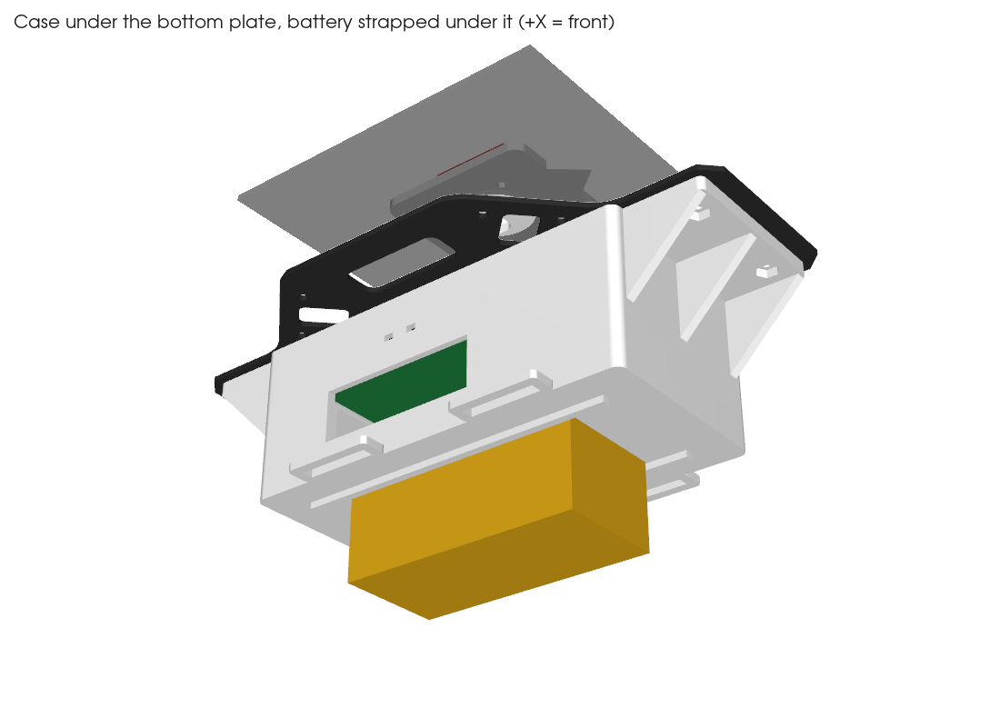

# Electronics case v0 + top-plate IMU mount

| | |
|---|---|
| **Date** | 2026-11-18 |
| **Status** | Superseded (sat on the arm screws; replaced by box rev 1) |

Printer used: Creality K1 SE, Hyper PLA, 0.4 mm nozzle (see the original README.txt for print settings).

### **STL files to slice and print**

- [`print/case.stl`](print/case.stl)
- [`print/imu_mount.stl`](print/imu_mount.stl)

### STEP files (open/edit in Fusion 360)

- [`step/assembly.step`](step/assembly.step)
- [`step/case.step`](step/case.step)
- [`step/imu_mount.step`](step/imu_mount.step)

### Pictures of the part

- [`renders/1_assembly_from_below.png`](renders/1_assembly_from_below.png)
- [`renders/2_side.png`](renders/2_side.png)
- [`renders/3_case_with_parts.png`](renders/3_case_with_parts.png)
- [`renders/4_case_bare.png`](renders/4_case_bare.png)
- [`renders/5_imu_mount.png`](renders/5_imu_mount.png)
- [`renders/6_top_view_keys.png`](renders/6_top_view_keys.png)

### CadQuery (Python) source - every size is a parameter

- [`src/case.py`](src/case.py)
- [`src/f450_bottom_plate.json`](src/f450_bottom_plate.json)
- [`src/render_vtk.py`](src/render_vtk.py)

### Original README / fit-check notes

- [`README.txt`](README.txt)
- [`fit_check.txt`](fit_check.txt)
