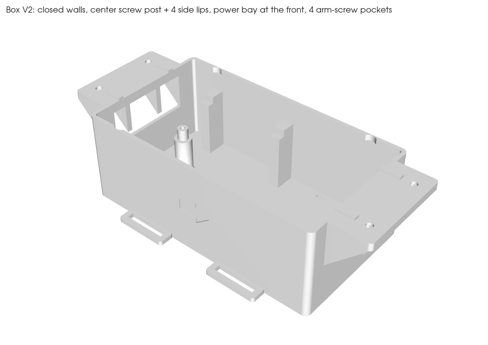

# Electronics box v2

| | |
|---|---|
| **Date** | 2026-11-18 |
| **Status** | Superseded by v3 |

Printer used: Creality K1 SE, Hyper PLA, 0.4 mm nozzle (see the original README.txt for print settings).

### **STL files to slice and print**

- [`print/box_v2.stl`](print/box_v2.stl)

### STEP files (open/edit in Fusion 360)

- [`step/assembly_v2.step`](step/assembly_v2.step)
- [`step/box_v2.step`](step/box_v2.step)

### Pictures of the part

- [`renders/1_box_v2_bare.png`](renders/1_box_v2_bare.png)
- [`renders/2_box_v2_with_parts.png`](renders/2_box_v2_with_parts.png)
- [`renders/3_front.png`](renders/3_front.png)
- [`renders/4_rear.png`](renders/4_rear.png)
- [`renders/5_under_frame.png`](renders/5_under_frame.png)
- [`renders/6_top_through_plate.png`](renders/6_top_through_plate.png)

### CadQuery (Python) source - every size is a parameter

- [`src/box_v2.py`](src/box_v2.py)
- [`src/f450_bottom_plate.json`](src/f450_bottom_plate.json)
- [`src/render_v2.py`](src/render_v2.py)

### Original README / fit-check notes

- [`README.txt`](README.txt)
- [`fit_check_v2.txt`](fit_check_v2.txt)
