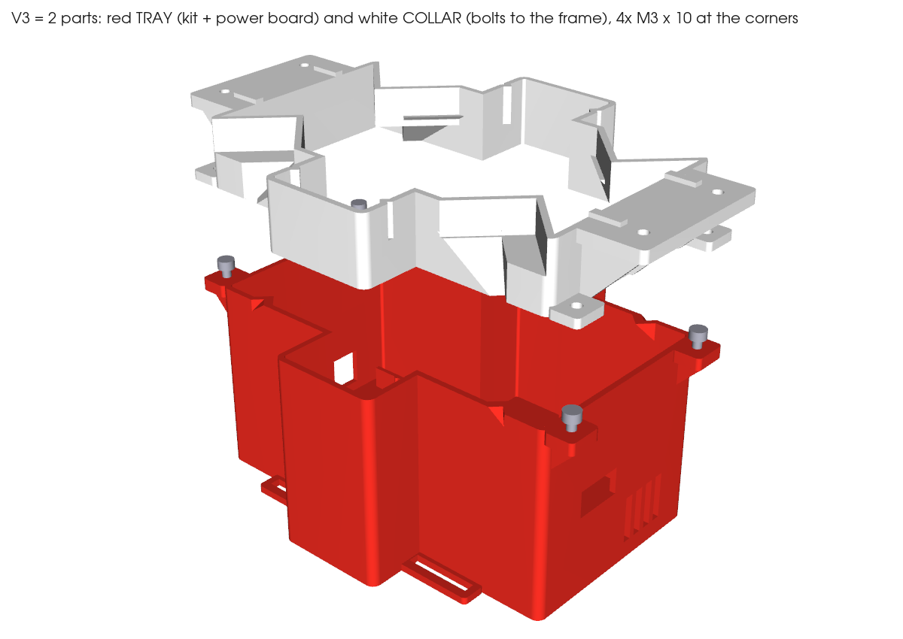

# Box v3: tray + collar (collar v3.1)

| | |
|---|---|
| **Date** | 2026-11-19 |
| **Status** | Tray v3 superseded by v4/v4.1. COLLAR v3.1 is still the collar to print |

Printer used: Creality K1 SE, Hyper PLA, 0.4 mm nozzle (see the original README.txt for print settings).

### **STL files to slice and print**

- [`print/collar_v3.stl`](print/collar_v3.stl)
- [`print/collar_v3_1.stl`](print/collar_v3_1.stl)
- [`print/test_cradle_v3.stl`](print/test_cradle_v3.stl)
- [`print/tray_v3.stl`](print/tray_v3.stl)

### STEP files (open/edit in Fusion 360)

- [`step/assembly_v3.step`](step/assembly_v3.step)
- [`step/collar_v3.step`](step/collar_v3.step)
- [`step/collar_v3_1.step`](step/collar_v3_1.step)
- [`step/tray_v3.step`](step/tray_v3.step)

### Pictures of the part

- [`renders/1_parts_exploded.png`](renders/1_parts_exploded.png)
- [`renders/2_tray_with_kit.png`](renders/2_tray_with_kit.png)
- [`renders/3_cradle_closeup.png`](renders/3_cradle_closeup.png)
- [`renders/4_left_end_ports.png`](renders/4_left_end_ports.png)
- [`renders/5_under_frame_legs.png`](renders/5_under_frame_legs.png)
- [`renders/6_leg_corner_closeup.png`](renders/6_leg_corner_closeup.png)
- [`renders/7_top_through_plate.png`](renders/7_top_through_plate.png)
- [`renders/8_print_plate.png`](renders/8_print_plate.png)
- [`renders/c1_collar_v3_1_iso.png`](renders/c1_collar_v3_1_iso.png)
- [`renders/c2_view_from_plate.png`](renders/c2_view_from_plate.png)
- [`renders/c3_under_frame.png`](renders/c3_under_frame.png)
- [`renders/c4_leg_corner.png`](renders/c4_leg_corner.png)
- [`renders/c5_on_tray.png`](renders/c5_on_tray.png)

### CadQuery (Python) source - every size is a parameter

- [`src/box_v3.py`](src/box_v3.py)
- [`src/collar_v3_1.py`](src/collar_v3_1.py)
- [`src/f450_bottom_plate.json`](src/f450_bottom_plate.json)
- [`src/render_collar_v3_1.py`](src/render_collar_v3_1.py)
- [`src/render_v3.py`](src/render_v3.py)

### Original README / fit-check notes

- [`README.txt`](README.txt)
- [`fit_check_collar_v3_1.txt`](fit_check_collar_v3_1.txt)
- [`fit_check_v3.txt`](fit_check_v3.txt)
