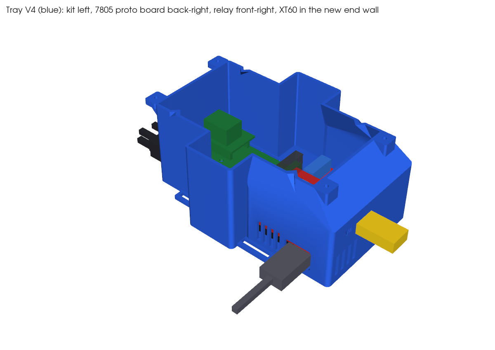

# Box v4 tray (relay bay, 45 deg roof)

| | |
|---|---|
| **Date** | 2026-11-24 |
| **Status** | Superseded by v4.1 (battery leads) |

Printer used: Creality K1 SE, Hyper PLA, 0.4 mm nozzle (see the original README.txt for print settings).

### **STL files to slice and print**

- [`print/test_bay_v4.stl`](print/test_bay_v4.stl)
- [`print/tray_v4.stl`](print/tray_v4.stl)

### STEP files (open/edit in Fusion 360)

- [`step/tray_v4.step`](step/tray_v4.step)

### Pictures of the part

- [`renders/1_tray_v4_loaded.png`](renders/1_tray_v4_loaded.png)
- [`renders/2_top_view.png`](renders/2_top_view.png)
- [`renders/3a_right_bay_empty_cutaway.png`](renders/3a_right_bay_empty_cutaway.png)
- [`renders/3b_right_bay_loaded_cutaway.png`](renders/3b_right_bay_loaded_cutaway.png)
- [`renders/4_back_wall_usb.png`](renders/4_back_wall_usb.png)
- [`renders/5_v3_vs_v4.png`](renders/5_v3_vs_v4.png)
- [`renders/6_under_frame.png`](renders/6_under_frame.png)
- [`renders/7_roof_section.png`](renders/7_roof_section.png)
- [`renders/8_print_plate.png`](renders/8_print_plate.png)

### CadQuery (Python) source - every size is a parameter

- [`src/box_v3.py`](src/box_v3.py)
- [`src/collar_v3_1.py`](src/collar_v3_1.py)
- [`src/f450_bottom_plate.json`](src/f450_bottom_plate.json)
- [`src/render_v4.py`](src/render_v4.py)
- [`src/tray_v4.py`](src/tray_v4.py)

### Original README / fit-check notes

- [`README.txt`](README.txt)
- [`fit_check_v4.txt`](fit_check_v4.txt)
