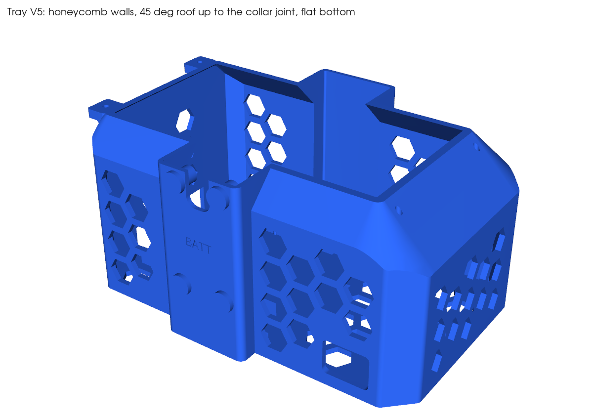

# Box v5 tray (honeycomb walls, flat bottom, 35% more room)

| | |
|---|---|
| **Date** | 2026-11-25 |
| **Status** | CURRENT tray - print with collar v3.1. Landing legs off: the box bottom is the landing face. Fit check 0 overlap with the collar, plate, kit, proto board, relay, leads and bullets; no supports. Not yet printed |

Printer used: Creality K2 Pro, standard PLA, 0.4 mm nozzle (print settings in README.txt).

### **STL files to slice and print**

- [`print/test_relay_bay_v5.stl`](print/test_relay_bay_v5.stl)
- [`print/tray_v5.stl`](print/tray_v5.stl)

### STEP files (open/edit in Fusion 360)

- [`step/tray_v5.step`](step/tray_v5.step)

### Pictures of the part

- [`renders/1_tray_v5.png`](renders/1_tray_v5.png)
- [`renders/2_tray_v5_loaded.png`](renders/2_tray_v5_loaded.png)
- [`renders/3_top_view.png`](renders/3_top_view.png)
- [`renders/4_size_vs_v4_1.png`](renders/4_size_vs_v4_1.png)
- [`renders/5_bottom_flat.png`](renders/5_bottom_flat.png)
- [`renders/6_on_the_drone.png`](renders/6_on_the_drone.png)
- [`renders/7_back_view.png`](renders/7_back_view.png)
- [`renders/8_cutaway.png`](renders/8_cutaway.png)
- [`renders/9_print_plate.png`](renders/9_print_plate.png)

### CadQuery (Python) source - every size is a parameter

- [`src/box_v3.py`](src/box_v3.py)
- [`src/collar_v3_1.py`](src/collar_v3_1.py)
- [`src/f450_bottom_plate.json`](src/f450_bottom_plate.json)
- [`src/fit_check_v5.py`](src/fit_check_v5.py)
- [`src/render_v5.py`](src/render_v5.py)
- [`src/tray_v5.py`](src/tray_v5.py)

### Original README / fit-check notes

- [`README.txt`](README.txt)
- [`fit_check_v5.txt`](fit_check_v5.txt)
