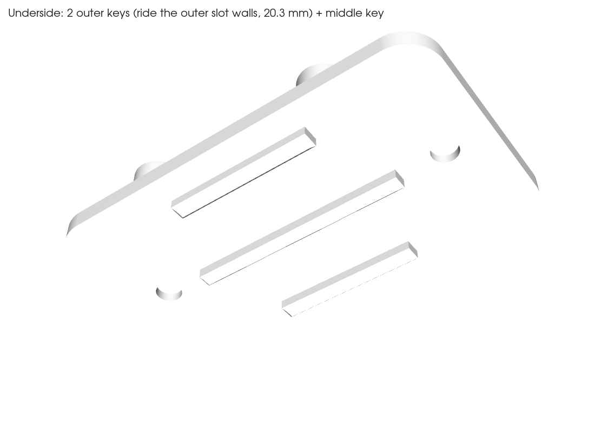

# IMU slot adapter v1

| | |
|---|---|
| **Date** | 2026-11-18 |
| **Status** | Superseded by v2 |

Printer used: Creality K1 SE, Hyper PLA, 0.4 mm nozzle (see the original README.txt for print settings).

### **STL files to slice and print**

- [`print/imu_adapter_loose.stl`](print/imu_adapter_loose.stl)
- [`print/imu_adapter_normal.stl`](print/imu_adapter_normal.stl)
- [`print/imu_adapter_snug.stl`](print/imu_adapter_snug.stl)

### Pictures of the part

- [`renders/adapter_bottom.png`](renders/adapter_bottom.png)
- [`renders/adapter_on_plate.png`](renders/adapter_on_plate.png)
- [`renders/adapter_top.png`](renders/adapter_top.png)

### CadQuery (Python) source - every size is a parameter

- [`src/imu_adapter.py`](src/imu_adapter.py)
- [`src/render_adapter.py`](src/render_adapter.py)

### Original README / fit-check notes

- [`README.txt`](README.txt)
- [`imu_adapter.step`](imu_adapter.step)
- [`imu_adapter_assembly.step`](imu_adapter_assembly.step)
- [`imu_adapter_fit.txt`](imu_adapter_fit.txt)
