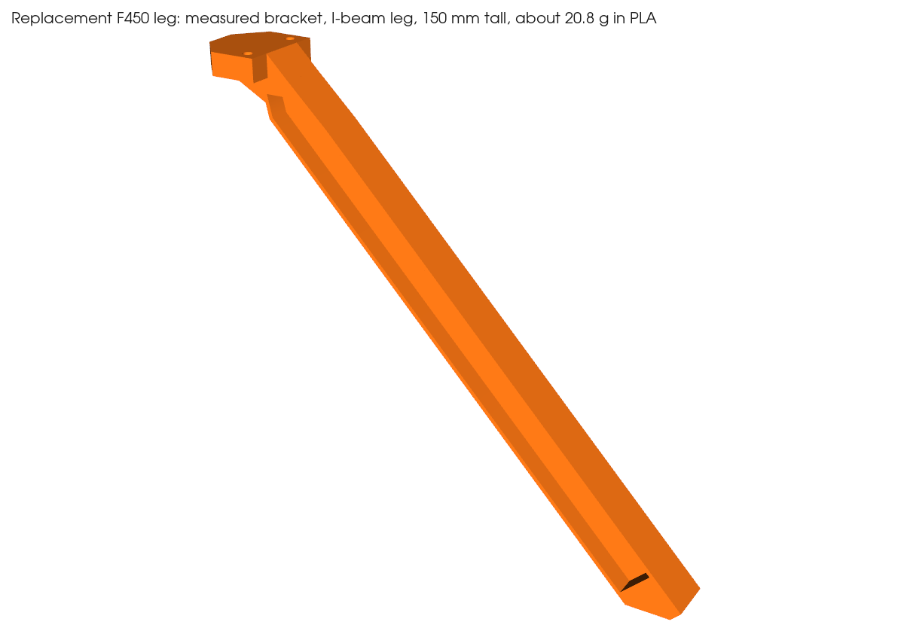

# F450 replacement landing leg v1

| | |
|---|---|
| **Date** | 2026-11-25 |
| **Status** | CURRENT. Fits collar v3.1 / tray v4.1 / the plate (0 overlap at all 4 corners), prints without supports, about 20.8 g. Bracket from calipers; height, lean and weight from listings until checked on a good leg |

Printer used: Creality K2 Pro, standard PLA, 0.4 mm nozzle (print settings in README.txt).

### **STL files to slice and print**

- [`print/f450_leg_as_mounted.stl`](print/f450_leg_as_mounted.stl)
- [`print/f450_leg_print.stl`](print/f450_leg_print.stl)

### STEP files (open/edit in Fusion 360)

- [`step/f450_leg.step`](step/f450_leg.step)

### Pictures of the part

- [`renders/1_leg_iso.png`](renders/1_leg_iso.png)
- [`renders/2_leg_underside.png`](renders/2_leg_underside.png)
- [`renders/3_on_drone.png`](renders/3_on_drone.png)
- [`renders/4_print_bed.png`](renders/4_print_bed.png)

### CadQuery (Python) source - every size is a parameter

- [`src/drawing.py`](src/drawing.py)
- [`src/f450_leg.py`](src/f450_leg.py)
- [`src/fit_check.py`](src/fit_check.py)
- [`src/print_check.py`](src/print_check.py)
- [`src/render_leg.py`](src/render_leg.py)

### Original README / fit-check notes

- [`README.txt`](README.txt)
- [`fit_check.txt`](fit_check.txt)
- [`leg_drawing.pdf`](leg_drawing.pdf)
- [`leg_drawing.png`](leg_drawing.png)
- [`print_check.txt`](print_check.txt)
