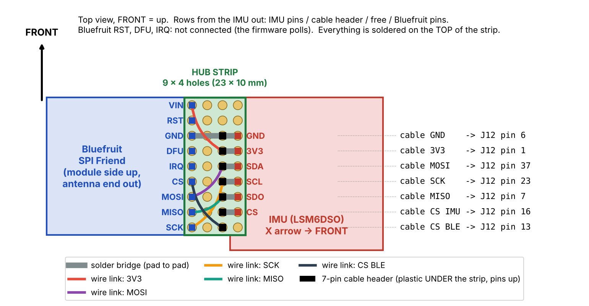

# Sensor deck v3 (IMU + Bluefruit + hub strip)

| | |
|---|---|
| **Date** | 2026-11-18 |
| **Status** | Superseded by v3.1 |

Printer used: Creality K1 SE, Hyper PLA, 0.4 mm nozzle (see the original README.txt for print settings).

### **STL files to slice and print**

- [`print/sensor_deck_v3_loose.stl`](print/sensor_deck_v3_loose.stl)
- [`print/sensor_deck_v3_normal.stl`](print/sensor_deck_v3_normal.stl)
- [`print/sensor_deck_v3_snug.stl`](print/sensor_deck_v3_snug.stl)

### STEP files (open/edit in Fusion 360)

- [`step/sensor_deck_v3.step`](step/sensor_deck_v3.step)
- [`step/sensor_deck_v3_assembly.step`](step/sensor_deck_v3_assembly.step)

### Pictures of the part

- [`renders/0_hub_wiring_diagram.png`](renders/0_hub_wiring_diagram.png)
- [`renders/1_deck_assembled.png`](renders/1_deck_assembled.png)
- [`renders/2_hub_closeup.png`](renders/2_hub_closeup.png)
- [`renders/3_top_view.png`](renders/3_top_view.png)
- [`renders/4_deck_bare.png`](renders/4_deck_bare.png)
- [`renders/5_print_orientation.png`](renders/5_print_orientation.png)

### CadQuery (Python) source - every size is a parameter

- [`src/f450_bottom_plate.json`](src/f450_bottom_plate.json)
- [`src/hub_diagram.py`](src/hub_diagram.py)
- [`src/render_v3.py`](src/render_v3.py)
- [`src/sensor_deck_v3.py`](src/sensor_deck_v3.py)

### Original README / fit-check notes

- [`README.txt`](README.txt)
- [`fit_check_v3.txt`](fit_check_v3.txt)
